<a id="top"></a>

<div align="center">



<br>

[](#student)
[](#student)
[](#student)

[](#python)
[](#csharp)
[](#csharp)
[](#python)
[](https://github.com/11OP-group/practice-StepanStepurov/commits/main)
[](https://github.com/11OP-group/practice-StepanStepurov)

<br>

[](#student)
[](#about)
[](#contents)
[](#python)
[](#csharp)
[](#structure)

[](#quickstart)
[](#run)
[](#examples)
[](#git)
[](#faq)

</div>

<br>

```console
root@keiit:~$ ./init --student
[ OK ] Загрузка профиля .............. Степан Степуров
[ OK ] Колледж ....................... Санкт-Петербургский колледж электроники и информационных технологий
[ OK ] Группа ........................ 11 ОП
[ OK ] Модули ........................ Python · C# · .NET · ООП
[ OK ] Статус ........................ ACTIVE
root@keiit:~$ _
```


<a id="student"></a>

## 🎓 Визитка студента

<table>
<tr>
<td width="300" align="center"></td>
<td>

| Параметр | Значение |
|:--|:--|
| 👤 **Студент** | Степан Степуров |
| 🏫 **Учебное заведение** | Санкт-Петербургский колледж электроники и информационных технологий (КЭиИТ) |
| 👥 **Группа** | 11 ОП |
| 📌 **Статус** | Действующий студент колледжа |
| 🧑‍🏫 **Преподаватели** | Ефимова А. Н. (Python) · Матысик И. А. (C#) |
| 🛠 **Направления** | Python · C# · .NET · ООП |
| 🔗 **Репозиторий** | [11OP-group/practice-StepanStepurov](https://github.com/11OP-group/practice-StepanStepurov) |
| 🏢 **Организация** | [11OP-group](https://github.com/11OP-group) |

</td>
</tr>
</table>

<p align="right"><a href="#top">⬆ Наверх</a></p>


<a id="about"></a>

## 📖 О проекте

Репозиторий объединяет учебные работы, исходный код и дополнительные материалы по двум направлениям — **Python** и **C#**. Структура организована по направлениям и типам заданий, поэтому нужный проект находится за пару кликов и запускается без сложной подготовки.

| Параметр | Значение |
|:--|:--|
| 🎯 **Цель** | Закрепление практических навыков программирования и алгоритмического мышления |
| 🧩 **Направления** | Python (основы и алгоритмы) · C# (проекты и ООП) |
| 📦 **Содержимое** | Исходный код, задачи на логику, методические материалы, презентации |
| 🗓️ **Формат** | Практические работы, задания «в конце пары», итоговые проекты |
| 🧭 **Принцип** | Одна тема — одна папка; рядом с кодом лежат материалы занятия |

> **ООП** в этом README означает *объектно-ориентированное программирование* (классы и объекты), а не название группы. Группа — **11 ОП**.

<p align="right"><a href="#top">⬆ Наверх</a></p>


<a id="contents"></a>

## 📚 Содержание

| # | Раздел | Что внутри | Переход |
|:-:|:--|:--|:-:|
| 01 | 🎓 Визитка студента | Колледж, группа, статус, преподаватели | [→](#student) |
| 02 | 📖 О проекте | Цели и формат репозитория | [→](#about) |
| 03 | 🐍 Python | Практики № 1–9, задачи на логику, задания в конце пары | [→](#python) |
| 04 | ⚙️ C# | Банковская задача, «Гладиатор», «Гладиатор через классы» | [→](#csharp) |
| 05 | 🗂️ Структура | Дерево папок репозитория | [→](#structure) |
| 06 | 🛠 Технологии | Стек и инструменты | [→](#stack) |
| 07 | 🚀 Быстрый старт | Клонирование, ZIP, Codespaces | [→](#quickstart) |
| 08 | ▶️ Запуск | Как запустить Python- и C#-проекты | [→](#run) |
| 09 | 🧪 Примеры | Примеры ввода и вывода | [→](#examples) |
| 10 | 🗺️ Прогресс | Статус разделов | [→](#progress) |
| 11 | 🌿 Git-шпаргалка | Основные команды и обновление репозитория | [→](#git) |
| 12 | ❓ FAQ | Частые вопросы | [→](#faq) |
| 13 | ⚖️ Академическая честность | Как пользоваться материалами | [→](#integrity) |

<p align="right"><a href="#top">⬆ Наверх</a></p>


<a id="python"></a>

## 🐍 Python — практические задания

> 📂 Папка: [`Практические задания для Ефимовой А.Н`](./Практические%20задания%20для%20Ефимовой%20А.Н/) &nbsp;·&nbsp; 📘 [Подробный README раздела](./Практические%20задания%20для%20Ефимовой%20А.Н/README.md)

Задания сгруппированы по занятиям и темам: у каждой работы своя папка с кодом и сопутствующими материалами.

| Раздел | Описание | Переход |
|:--|:--|:-:|
| **Практика № 1–9** | Последовательные практические работы по темам занятий | [📂](./Практические%20задания%20для%20Ефимовой%20А.Н/) |
| **Задачи на логику (13.10.26)** | Дополнительные задачи для тренировки алгоритмического мышления | [📂](./Практические%20задания%20для%20Ефимовой%20А.Н/) |
| **Задания в конце пары** | Короткие упражнения, сгруппированные по датам | [📂](./Практические%20задания%20для%20Ефимовой%20А.Н/) |
| **Методические материалы** | Документы и презентации к занятиям | [📂](./Практические%20задания%20для%20Ефимовой%20А.Н/) |

### 🗓️ Задания в конце пары

| Дата | Тема | Задачи | Папка |
|:-:|:--|:--|:-:|
| **05.10.26** | Ветвления. Условный оператор `if / elif / else` | 5 задач: проверка года, тип треугольника, количество дней в месяце, весовая категория, смешивание цветов | [📂](./Практические%20задания%20для%20Ефимовой%20А.Н/Задание%20в%20конце%20пары%2805.10.26%29/) |
| **19.10.26** | Арифметический цикл `for` | 4 задачи: чётные числа, факториал, вывод диапазона `m…n` в любом направлении, отбор чисел по условиям делимости | [📂](./Практические%20задания%20для%20Ефимовой%20А.Н/Задание%20в%20конце%20пары%2819.10.26%29/) |

### 🔬 Разбор задач

<details>
<summary><b>05.10.26 · Ветвления — 5 задач</b> (нажмите, чтобы раскрыть)</summary>

<br>

| № | Задача | Идея решения | Файл |
|:-:|:--|:--|:--|
| 1 | Проверка года | Условие на остаток от деления `year % 100` | `Задание 1.py` |
| 2 | Тип треугольника | Сначала проверка существования, затем равносторонний → равнобедренный → разносторонний | `Задание 2.py` |
| 3 | Количество дней в месяце | Февраль — 28, месяцы 4, 6, 9, 11 — 30, остальные — 31 | `Задание 3.py` |
| 4 | Весовая категория | Цепочка `if / elif / else` по границам веса | `Задание 4.py` |
| 5 | Смешивание цветов | Симметричные пары цветов через `and` / `or`, ветка `else` для ошибок | `Задание 5.py` |

</details>

<details>
<summary><b>19.10.26 · Цикл for — 4 задачи</b> (нажмите, чтобы раскрыть)</summary>

<br>

| № | Задача | Идея решения | Файл |
|:-:|:--|:--|:--|
| 1 | Чётные числа от 2 до 20 | `range(2, 21, 2)` | `Задание 1.py` |
| 2 | Факториал `n!` | Накопление произведения в цикле | `Задание 2.py` |
| 3 | Числа от `m` до `n` | Ветвление по направлению: по возрастанию или по убыванию | `Задание 3.py` |
| 4 | Отбор чисел из диапазона | Условия делимости на 17 и 15, окончание на 9 | `Задание 4.py` |

</details>

### 🔑 Освоенные темы

| Тема | Конструкции |
|:--|:--|
| Ввод и вывод | `input()`, `print()`, f-строки |
| Преобразование типов | `int()` |
| Ветвления | `if`, `elif`, `else`, составные условия `and` / `or` |
| Циклы | `for`, `range()` с шагом, обратный порядок |
| Арифметика | `%`, `*`, накопление результата в цикле |

<p align="right"><a href="#top">⬆ Наверх</a></p>


<a id="csharp"></a>

## ⚙️ C# — учебные проекты

> 📂 Папка: [`Практические задания для Матысик И.A`](./Практические%20задания%20для%20Матысик%20И.A) &nbsp;·&nbsp; 📘 [Подробный README раздела](./Практические%20задания%20для%20Матысик%20И.A/project_final/README.md)

| Проект | Описание | Ключевые идеи |
|:--|:--|:--|
| 🏦 **Банковская задача** | Учебная программа для работы с банковскими данными | Обработка данных, логика операций |
| ⚔️ **Гладиатор** | Модель гладиаторского поединка | Алгоритм боя, управление состоянием |
| 🛡️ **Гладиатор через классы** | Та же задача в объектно-ориентированном стиле | Классы, объекты, инкапсуляция |

> 💡 Пара «Гладиатор» и «Гладиатор через классы» наглядно показывает переход от процедурного подхода к ООП: задача одна, архитектура решения разная.

| От процедурного подхода | К объектно-ориентированному |
|:--|:--|
| Логика боя в одном месте | Логика разнесена по классам |
| Данные и действия отдельно | Данные и поведение вместе в объекте |
| Сложнее расширять | Проще добавлять новых персонажей и правила |

<p align="right"><a href="#top">⬆ Наверх</a></p>


<a id="structure"></a>

## 🗂️ Структура репозитория

```text
practice-StepanStepurov/
├── README.md
├── assets/                                          # оформление README
│   ├── banner.svg                                   # главный баннер
│   ├── divider.svg                                  # разделитель секций
│   ├── footer.svg                                   # нижний баннер
│   ├── keiit-logo.png                               # логотип колледжа
│   └── social-preview.png                           # картинка для превью ссылки (1280×640)
│
├── Практические задания для Ефимовой А.Н/           # 🐍 Python
│   ├── README.md
│   ├── Практика№1/ … Практика№9/
│   ├── Задачи на логику (13.10.26)/
│   ├── Задание в конце пары(05.10.26)/
│   │   ├── Задание 1.py … Задание 5.py
│   │   └── Программирование ветвлений. Условный оператор.pptx
│   └── Задание в конце пары(19.10.26)/
│       ├── Задание 1.py … Задание 4.py
│       └── Оператор арифметического цикла. Цикл с параметром - FOR.pptx
│
└── Практические задания для Матысик И.A/            # ⚙️ C#
        ├── README.md
        ├── Банковская задача
        ├── Гладиатор
        └── Гладиатор через классы
```

| Обозначение | Значение |
|:-:|:--|
| 🐍 | Раздел на Python |
| ⚙️ | Раздел на C# |
| `.py` | Исходный код Python |
| `.pptx` | Презентации к занятиям |
| `assets/` | Картинки для README, на запуск кода не влияют |

<p align="right"><a href="#top">⬆ Наверх</a></p>


<a id="stack"></a>

## 🛠 Технологии

| Технология | Применение |
|:--|:--|
|  | Основы программирования, алгоритмы, логика |
|  | Консольные приложения, ООП |
|  | Платформа сборки и запуска C#-проектов |
|  | Контроль версий |
|  | Хранение и публикация работ |
|  | Документация |

**Концепции:** объектно-ориентированное программирование · основы алгоритмизации · ветвления · циклы · работа с вводом и выводом.

<p align="right"><a href="#top">⬆ Наверх</a></p>


<a id="quickstart"></a>

## 🚀 Быстрый старт

<div align="center">

[](https://github.com/11OP-group/practice-StepanStepurov)
[](https://github.com/11OP-group/practice-StepanStepurov/archive/refs/heads/main.zip)
[](https://codespaces.new/11OP-group/practice-StepanStepurov)
[](https://github.dev/11OP-group/practice-StepanStepurov)
[](https://github.com/11OP-group/practice-StepanStepurov/commits/main)

</div>

### Способ 1 — клонирование через Git

Убедитесь, что установлен [Git](https://git-scm.com/), затем выполните:

```bash
git clone https://github.com/11OP-group/practice-StepanStepurov.git
cd practice-StepanStepurov
```

### Способ 2 — скачать архив

Нажмите кнопку **«СКАЧАТЬ ZIP»** выше, распакуйте архив и откройте папку в редакторе кода.

### Способ 3 — без установки

Кнопки **Codespaces** и **github.dev** открывают репозиторий прямо в браузере.

### ⚙️ Требования

| Инструмент | Версия | Для чего | Где взять |
|:--|:--|:--|:-:|
| Python | 3.x | Запуск заданий на Python | [python.org](https://www.python.org/downloads/) |
| .NET SDK | актуальная LTS | Сборка и запуск проектов на C# | [dotnet.microsoft.com](https://dotnet.microsoft.com/download) |
| Git | любая | Клонирование репозитория | [git-scm.com](https://git-scm.com/downloads) |
| Редактор кода | любой | VS Code, PyCharm, Visual Studio, Rider | [code.visualstudio.com](https://code.visualstudio.com/) |

Поддерживаются **Windows**, **macOS** и **Linux**.

Проверить установку:

```bash
python --version      # на macOS и Linux: python3 --version
dotnet --version
git --version
```

<p align="right"><a href="#top">⬆ Наверх</a></p>


<a id="run"></a>

## ▶️ Запуск проектов

### 🐍 Python

```bash
cd "Практические задания для Ефимовой А.Н/Задание в конце пары(19.10.26)"
python "Задание 1.py"
```

> На macOS и Linux используйте `python3` вместо `python`.

### ⚙️ C#

```bash
cd "Практические задания для Матысик И.A/project_final"
dotnet run
```

> Если внутри `project_final` несколько проектов, перейдите в папку нужного проекта (там, где лежит файл `.csproj`) и выполните `dotnet run` оттуда.

Подробные инструкции по каждому проекту находятся в README внутри соответствующих папок.

| Раздел | README |
|:--|:-:|
| 🐍 Python | [📘 Открыть](./Практические%20задания%20для%20Ефимовой%20А.Н/README.md) |
| ⚙️ C# | [📘 Открыть](./Практические%20задания%20для%20Матысик%20И.A/project_final/README.md) |

<p align="right"><a href="#top">⬆ Наверх</a></p>


<a id="examples"></a>

## 🧪 Примеры работы

<details>
<summary><b>🔺 Тип треугольника</b> — <code>Задание 2.py</code> (05.10.26)</summary>

```text
Введите сторону 1: 3
Введите сторону 2: 4
Введите сторону 3: 5
Тип: Разносторонний
```

```text
Введите сторону 1: 1
Введите сторону 2: 2
Введите сторону 3: 10
Ошибка: такого треугольника не существует
```

</details>

<details>
<summary><b>📅 Количество дней в месяце</b> — <code>Задание 3.py</code> (05.10.26)</summary>

```text
Введите номер месяца: 4
Количество дней: 30
```

</details>

<details>
<summary><b>🎨 Смешивание цветов</b> — <code>Задание 5.py</code> (05.10.26)</summary>

```text
Введите первый цвет: красный
Введите второй цвет: синий
Получился: фиолетовый
```

</details>

<details>
<summary><b>🔢 Факториал</b> — <code>Задание 2.py</code> (19.10.26)</summary>

```text
Введите n: 5
120
```

</details>

<details>
<summary><b>↕️ Числа от m до n в любом направлении</b> — <code>Задание 3.py</code> (19.10.26)</summary>

```text
Введите m: 7
Введите n: 3
7
6
5
4
3
```

</details>

<p align="right"><a href="#top">⬆ Наверх</a></p>


<a id="progress"></a>

## 🗺️ Прогресс

| Раздел | Статус |
|:--|:-:|
| 🐍 Практики № 1–9 | ✅ Выполнено |
| 🐍 Задачи на логику (13.10.26) | ✅ Выполнено |
| 🐍 Задания в конце пары | 🔄 Пополняется |
| ⚙️ Банковская задача | ✅ Выполнено |
| ⚙️ Гладиатор | ✅ Выполнено |
| ⚙️ Гладиатор через классы | ✅ Выполнено |

<p align="right"><a href="#top">⬆ Наверх</a></p>


<a id="git"></a>

## 🌿 Git-шпаргалка

| Действие | Команда |
|:--|:--|
| Клонировать репозиторий | `git clone https://github.com/11OP-group/practice-StepanStepurov.git` |
| Посмотреть изменения | `git status` |
| Добавить файлы | `git add .` |
| Зафиксировать изменения | `git commit -m "Описание изменений"` |
| Отправить на GitHub | `git push` |
| Получить обновления | `git pull` |

<details>
<summary><b>Как добавить новое задание</b> (нажмите, чтобы раскрыть)</summary>

<br>

```bash
git pull
# положите файл в папку нужного занятия
git add .
git commit -m "Добавлено задание от 02.11.26"
git push
```

</details>

<p align="right"><a href="#top">⬆ Наверх</a></p>


<a id="faq"></a>

## ❓ FAQ

<details>
<summary><b>Какая версия Python нужна?</b></summary>

<br>

Подойдёт любая актуальная версия Python 3. В заданиях используются только стандартные возможности языка.

</details>

<details>
<summary><b>Как запустить C#-проект?</b></summary>

<br>

Установите .NET SDK, перейдите в папку проекта и выполните `dotnet run`. Также проект можно открыть в Visual Studio или Rider.

</details>

<details>
<summary><b>Почему в названиях папок кириллица и пробелы?</b></summary>

<br>

Папки названы по темам и датам занятий. В консоли такие пути нужно брать в кавычки, например `cd "Задание в конце пары(19.10.26)"`.

</details>

<details>
<summary><b>Где методические материалы?</b></summary>

<br>

Презентации и документы лежат рядом с заданиями соответствующего занятия.

</details>

<details>
<summary><b>Можно ли открыть репозиторий без установки программ?</b></summary>

<br>

Да. Используйте кнопки **Codespaces** или **github.dev** в разделе [«Быстрый старт»](#quickstart).

</details>

<details>
<summary><b>Что означает ООП?</b></summary>

<br>

Объектно-ориентированное программирование — подход, в котором программа строится из классов и объектов. Это не название группы.

</details>

<p align="right"><a href="#top">⬆ Наверх</a></p>


<a id="integrity"></a>

## ⚖️ Академическая честность

Материалы репозитория созданы в учебных целях. Используйте их как справочник и ориентир, а свои работы выполняйте самостоятельно: так навык закрепляется лучше всего.

<br>

<div align="center">



<br>

[⬆ Вернуться наверх](#top) &nbsp;·&nbsp; [🎓 Визитка](#student) &nbsp;·&nbsp; [📚 Содержание](#contents) &nbsp;·&nbsp; [🏢 11OP-group](https://github.com/11OP-group)

*Учебный репозиторий по программированию · README обновлён 30.10.2026*

</div>
